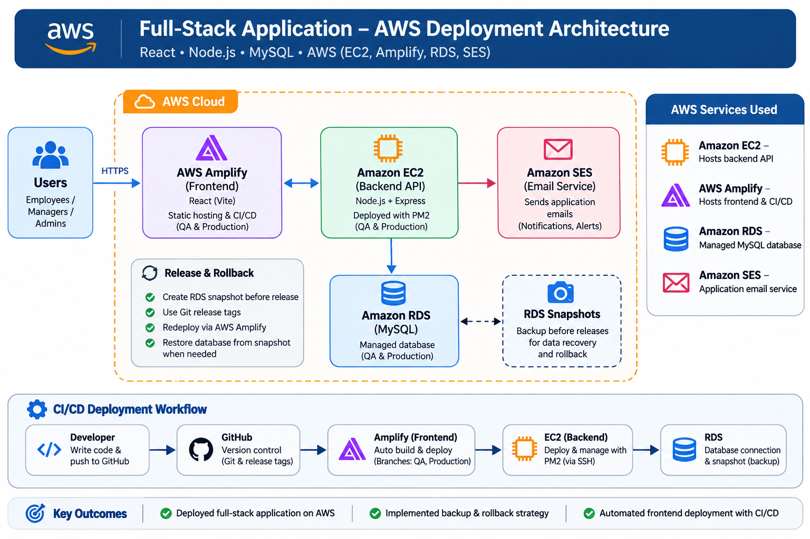

# Full-Stack Application – AWS Deployment Architecture

## Project Overview
This repository documents the AWS deployment architecture of a full-stack time-tracking web application built with React.js, Node.js, Express.js and MySQL.

## AWS Services
- Amazon EC2 – Backend hosting
- AWS Amplify – Frontend hosting and CI/CD
- Amazon RDS (MySQL) – Managed database hosting
- Amazon SES – Application email service

## Architecture Diagram

## Deployment Workflow
1. Source code is maintained in GitHub.
2. AWS Amplify builds and deploys the frontend.
3. The Node.js backend runs on Amazon EC2.
4. The backend connects to Amazon RDS.
5. Amazon SES handles application email notifications.
6. RDS snapshots support database backup and recovery.

## Technology Stack
React.js | Node.js | Express.js | MySQL | AWS | Git | PM2

## Purpose
To document the cloud architecture, AWS services and deployment workflow of a full-stack application.
